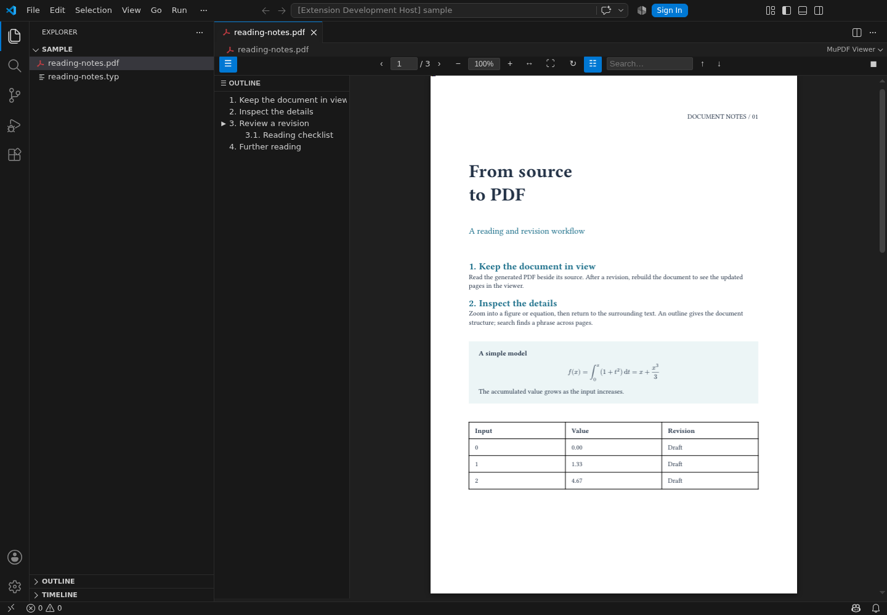
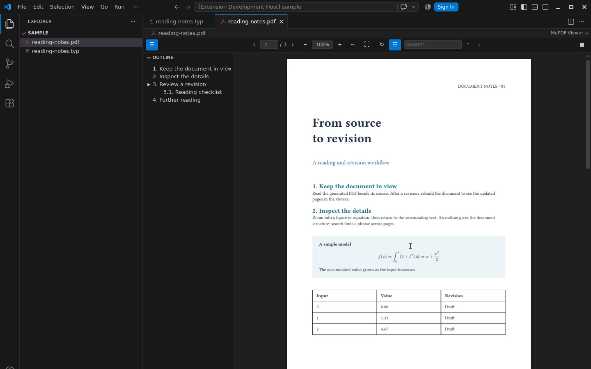
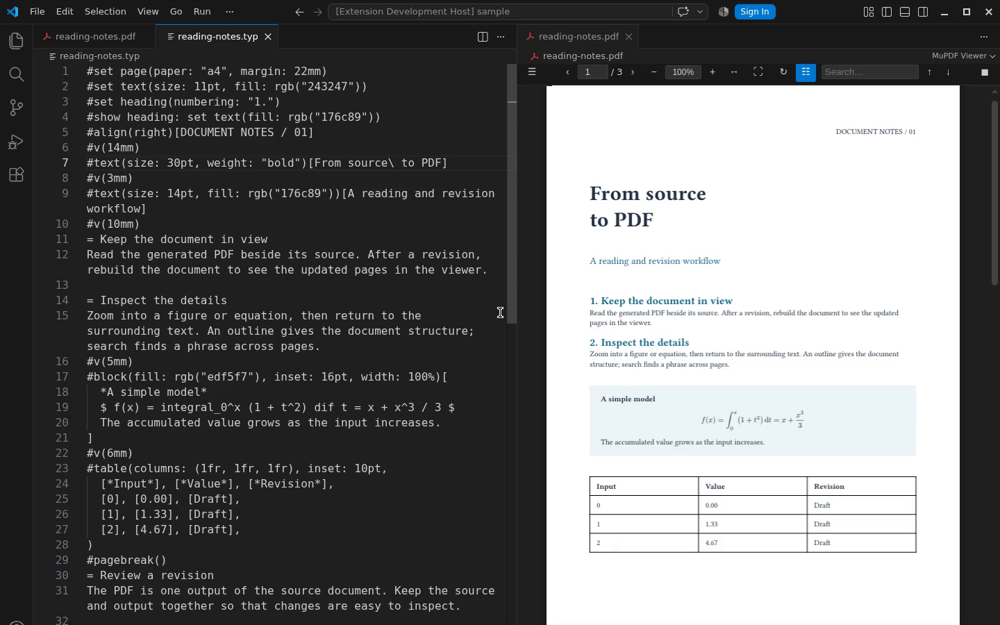
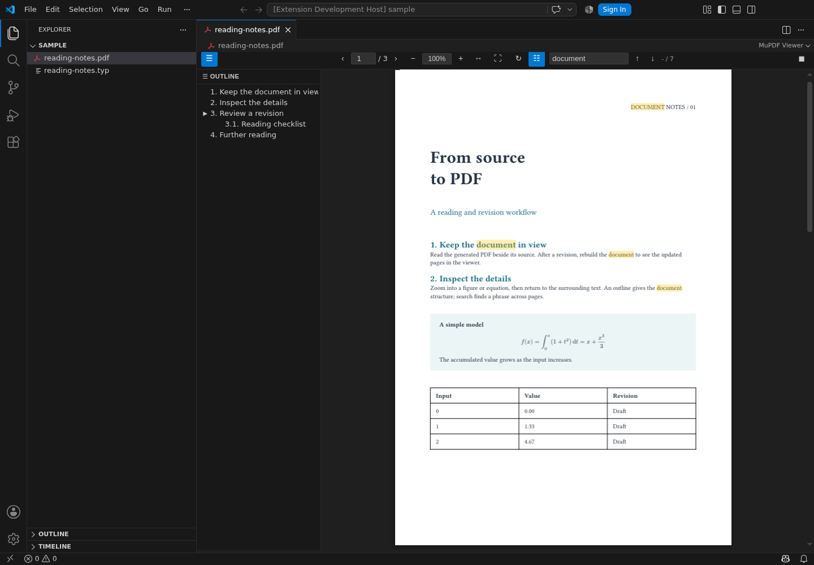

# MuPDF Viewer

[English](README.md) | 日本語

[](https://marketplace.visualstudio.com/items?itemName=skrtk98.mupdf-viewer)
[](https://open-vsx.org/extension/skrtk98/mupdf-viewer)

LaTeX や Typst の出力が更新されると自動で再読み込みする、VS Code 用の PDF ビューアです。マウス位置を基点としたズーム、検索、アウトラインからのページ移動に対応しています。
描画には、WebAssembly にコンパイルした [MuPDF](https://github.com/ArtifexSoftware/mupdf) を使っています。



## MuPDF Viewer を選ぶ理由

生成した PDF をソースファイルの隣に開いて、作業中に確認できます。
LaTeX や Typst などで文書を再ビルドすると、ディスク上の PDF の更新に応じて表示が再読み込みされます。
ビルドには普段のツールを使い、MuPDF Viewer で閲覧とページ移動を行えます。

リモートマシン上の大きな PDF もすぐに開けます。Remote-SSH 越しでも回線の速度でファイルを読み込み、読み込みの進み具合を表示します。

## 主な機能

- **自動再読み込み**：開いている PDF がディスク上で変更されると表示を更新。
- **マウス位置を基点としたズーム**：`Ctrl+ホイール` または `マウス右ボタン+ホイール` で拡大縮小。
- **2 つの表示モード**：連続スクロールと単ページ表示を切り替え。
- **リモートでも高速に表示**：Remote-SSH 越しの大きな PDF も、進み具合を表示しながら読み込み。
- **制限モードでも利用可能**：信頼済みにしていないフォルダの PDF も表示。
- **ナビゲーション**：アウトライン、サムネイル、ページ番号、PDF 内の内部リンクと外部リンクに対応。
- **検索とテキスト選択**：文書全体の検索、テキストの選択とコピー。
- **画像コピーと回転**：画像を PNG としてコピーし、ページ単位で回転。

## デモ

右ボタンを押しながらホイールを回すと、数式の上に置いたマウス位置を基点にズームできます。



Typst ソースを編集して再ビルドすると、隣に開いた PDF の表示が自動更新されます。



アウトラインを表示しながら文書全体を検索できます。



## 使い方

VS Code で任意の `.pdf` ファイルを開くと、カスタムエディタとして自動的にビューワーが起動します。
ファイルがディスク上で変更された場合も自動的に再読み込みされます。

### 表示モード

ツールバーの **スクロール/単ページ** 切り替えボタンで以下のモードを切り替えられます。

- **スクロールモード**（デフォルト）：全ページを連続表示
- **単ページモード**：1 ページずつ表示

### ズーム

| 操作 | 動作 |
|------|------|
| `Ctrl+ホイール` | マウス位置を基点にズームイン/アウト |
| `マウス右ボタン+ホイール` | マウス位置を基点にズームイン/アウト |
| `+` / `=` | ズームイン |
| `-` | ズームアウト |
| 幅に合わせるボタン | コンテナ幅に合わせてスケール |
| ページに合わせるボタン | ページ全体が収まるようにスケール |
| ズーム入力欄 | パーセント（例: `150%`）または小数（例: `1.5`）で入力 |

### ナビゲーション

| 操作 | 動作 |
|------|------|
| `PageDown` / `ArrowRight` | 次のページ |
| `PageUp` / `ArrowLeft` | 前のページ |
| ページ番号入力欄 | 指定ページへジャンプ |
| アウトラインサイドバーの項目 | ブックマークページへジャンプ |
| サムネイル | 対応するページへジャンプ |
| リンクをクリック | リンク先のページへジャンプ、または外部URLをブラウザで開く |

### テキスト選択とコピー

- **クリックしてドラッグ** でテキストを選択。
- **ダブルクリック** で単語を選択。
- **Ctrl+C** で選択テキストをクリップボードにコピー。

### 検索

検索ボックスに入力するとドキュメント全体からテキストを検索します。
**Enter** / **Shift+Enter** または矢印ボタンでヒット間を移動できます。

### コンテキストメニュー

画像を右クリックすると PNG としてコピーできます。

### 回転

回転ボタンをクリックすると現在のページを 90° 時計回りに回転します。

## 設定

| キー | 型 | デフォルト | 説明 |
|------|----|-----------|------|
| `pdfViewer.defaultZoom` | number | `1.0` | 初期ズーム倍率（1.0 = 100%）。0.1〜16 の範囲。 |
| `pdfViewer.renderResolution` | number | `96` | レンダリング解像度（DPI）。48〜384 の範囲。高いほど高品質だがメモリ使用量が増加する。制限モードではユーザー設定の値だけを使う。 |

## インストール

[Visual Studio Marketplace](https://marketplace.visualstudio.com/items?itemName=skrtk98.mupdf-viewer) で **skrtk98** の **MuPDF Viewer** をインストールするか、次のコマンドを実行します。

```sh
code --install-extension skrtk98.mupdf-viewer
```

Open VSX を利用する環境では、[Open VSX Registry](https://open-vsx.org/extension/skrtk98/mupdf-viewer) からインストールできます。

PDF を開くと閲覧を開始できます。
別の拡張機能で開く場合は、エディタのタブを右クリックし、**エディターを開くアプリケーションの選択…**（Reopen Editor With…）から **MuPDF Viewer** を選択します。

ほかの PDF 拡張機能を入れたまま、常に MuPDF Viewer で開くには、`settings.json` に次の設定を追加します。

```json
"workbench.editorAssociations": {
  "*.pdf": "pdfViewer.pdfEditor"
}
```

## ライセンス

[AGPL-3.0](LICENSE) で提供しています。
