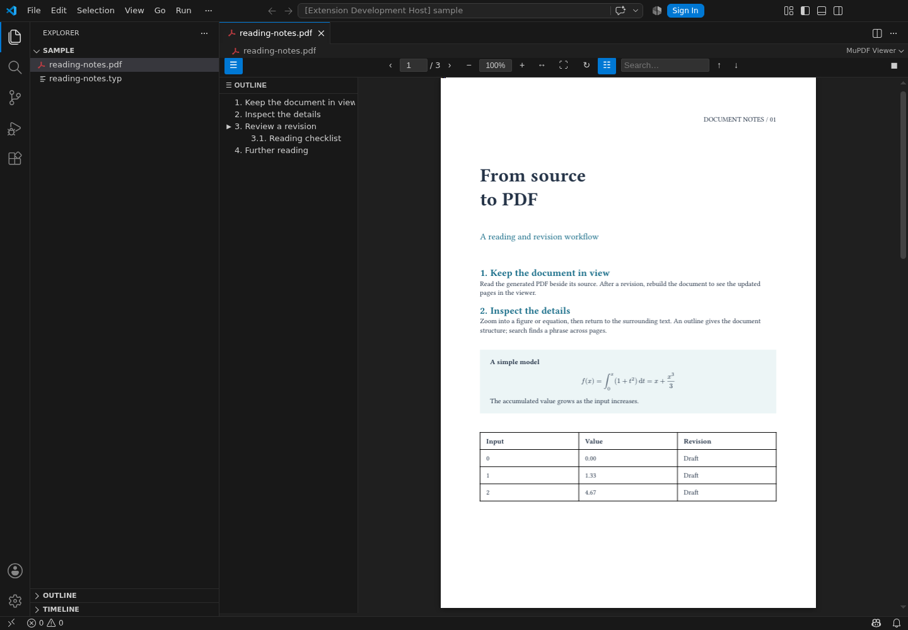
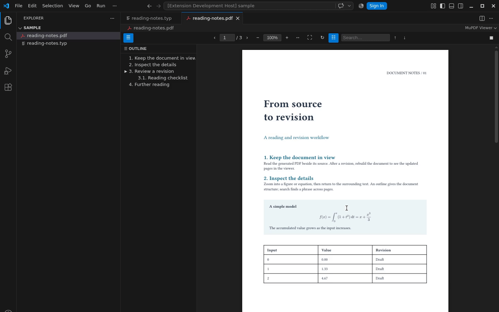
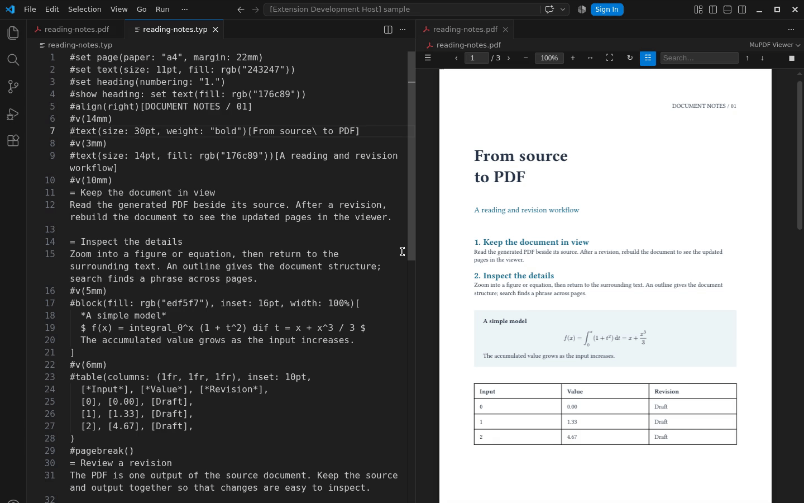
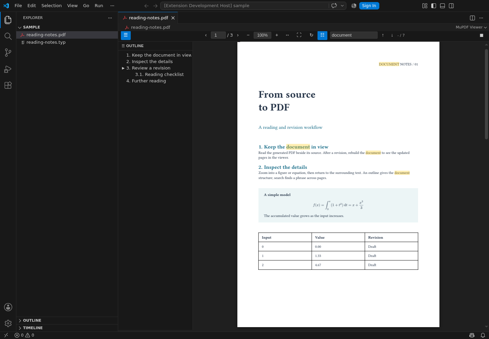

# MuPDF Viewer

English | [日本語](README.ja.md)

[](https://marketplace.visualstudio.com/items?itemName=skrtk98.mupdf-viewer)
[](https://open-vsx.org/extension/skrtk98/mupdf-viewer)

A PDF viewer for VS Code that reloads when your LaTeX or Typst output changes, with mouse-centered zoom, search, and outline navigation.
Rendering uses [MuPDF](https://github.com/ArtifexSoftware/mupdf) compiled to WebAssembly.



## Why MuPDF Viewer?

Keep a generated PDF beside its source while you work.
For LaTeX, Typst, or other tools that generate PDFs, rebuild the document and the viewer reloads the updated file from disk.
Use your existing build tools; MuPDF Viewer handles viewing and navigation.

Large PDFs on a remote machine open quickly too: over Remote-SSH, the viewer streams the file at the speed of the connection and shows how much has loaded.

## Highlights

- **Automatic reload** — See updates when the open PDF changes on disk.
- **Mouse-centered zoom** — Zoom around the cursor with `Ctrl+Wheel` or `Right mouse button+Wheel`.
- **Two view modes** — Switch between continuous scrolling and single-page reading.
- **Fast remote loading** — Open large PDFs over Remote-SSH with a progress indicator.
- **Works in Restricted Mode** — Read PDFs in folders you have not marked as trusted.
- **Navigation** — Use outlines, thumbnails, page numbers, and internal or external PDF links.
- **Search and text selection** — Find text throughout the document, select it, and copy it.
- **Image copy and rotation** — Copy images as PNG and rotate individual pages.

## Demo

Zoom around an equation with the right mouse button held while scrolling.



Edit the Typst source and rebuild to see the PDF reload alongside it.



Search the document while keeping its outline visible.



## Usage

Open any `.pdf` file in VS Code — the viewer opens automatically as a custom editor. The viewer also reloads automatically whenever the file changes on disk.

### View modes

Click the **scroll/page** toggle button in the toolbar to switch between:

- **Scroll mode** (default) — all pages rendered continuously
- **Single-page mode** — one page at a time

### Zoom

| Action | Result |
|--------|--------|
| `Ctrl+Wheel` | Zoom in/out anchored to the mouse position |
| `Right mouse button+Wheel` | Zoom in/out anchored to the mouse position |
| `+` / `=` | Zoom in |
| `-` | Zoom out |
| Fit Width button | Scale to fill the container width |
| Fit Page button | Scale to fit the entire page |
| Zoom input field | Type a percentage (e.g. `150%`) or a decimal (e.g. `1.5`) |

### Navigation

| Action | Result |
|--------|--------|
| `PageDown` / `ArrowRight` | Next page |
| `PageUp` / `ArrowLeft` | Previous page |
| Page number input | Jump to a specific page |
| Outline sidebar entry | Jump to the bookmarked page |
| Thumbnail | Jump to the corresponding page |
| Click a link | Jump to the linked page, or open external URLs in the browser |

### Text selection and copy

- **Click and drag** to select text.
- **Double-click** to select a word.
- **Ctrl+C** to copy the selected text to the clipboard.

### Search

Type in the search box to find text across the document.  
Press **Enter** / **Shift+Enter** or use the arrow buttons to navigate between hits.

### Context menu

Right-click on an image to copy it as PNG.

### Rotation

Click the rotate button to rotate the current page 90° clockwise.

## Settings

| Key | Type | Default | Description |
|-----|------|---------|-------------|
| `pdfViewer.defaultZoom` | number | `1.0` | Initial zoom level (1.0 = 100%), from 0.1 to 16. |
| `pdfViewer.renderResolution` | number | `96` | Render resolution in DPI, from 48 to 384. Higher values produce sharper output at the cost of more memory. In Restricted Mode, only the user setting is used. |

## Installation

Install **MuPDF Viewer** by **skrtk98** from the [Visual Studio Marketplace](https://marketplace.visualstudio.com/items?itemName=skrtk98.mupdf-viewer), or run:

```sh
code --install-extension skrtk98.mupdf-viewer
```

For clients that use Open VSX, install from the [Open VSX Registry](https://open-vsx.org/extension/skrtk98/mupdf-viewer).

Open a PDF to start reading.
If another extension opens it, right-click the editor tab, choose **Reopen Editor With…**, and select **MuPDF Viewer**.

To always open PDFs with MuPDF Viewer when another PDF extension is installed, add this to your `settings.json`:

```json
"workbench.editorAssociations": {
  "*.pdf": "pdfViewer.pdfEditor"
}
```

## Development and releases

See the [release guide](docs/releasing.md) for local checks, VSIX packaging, and publishing to Visual Studio Marketplace and Open VSX.

## License

Licensed under [AGPL-3.0](LICENSE).
